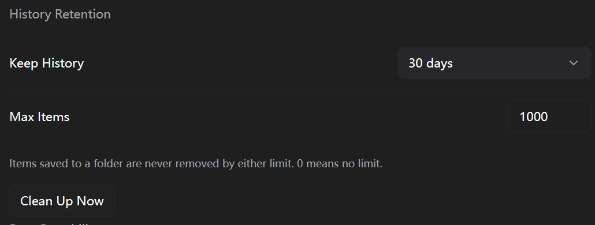
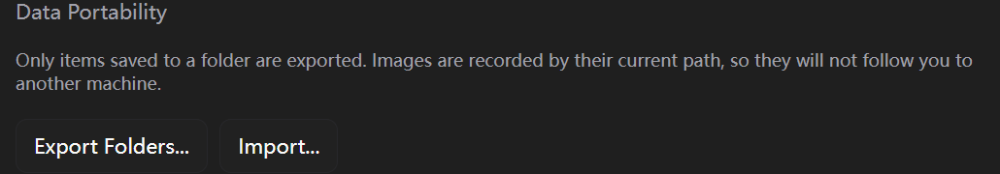
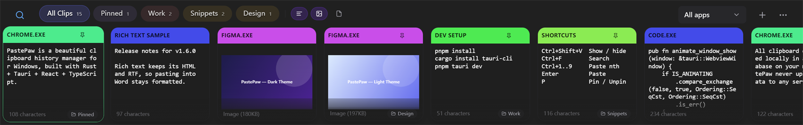
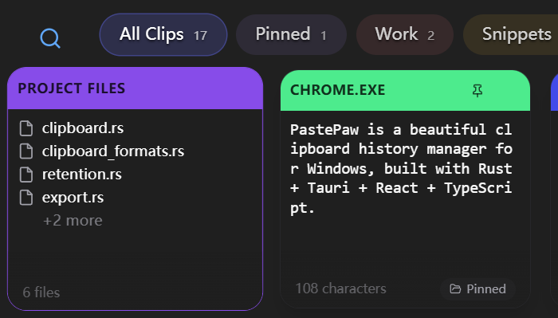
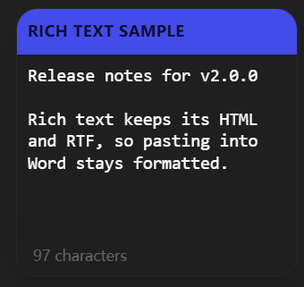
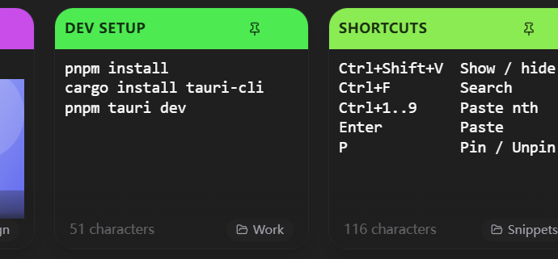
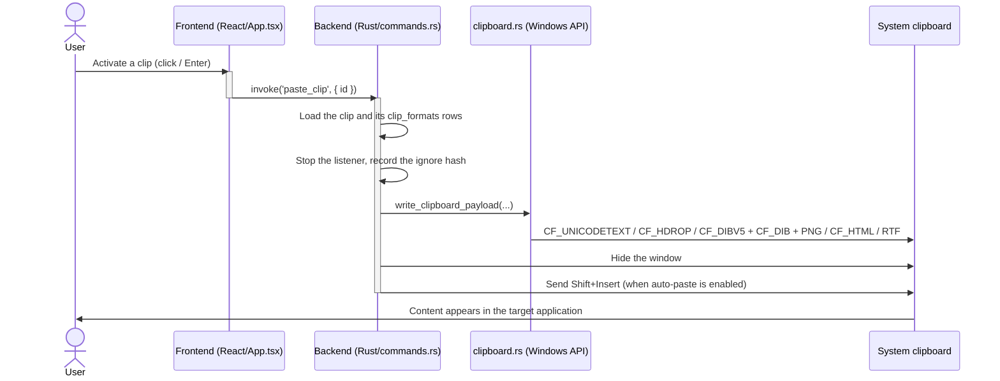

<h1 align="center">
    <picture>
      
    </picture>
    VigilClip - Clipboard History Manager
</h1>


<p align="center">
  <a href="README_CN.md">中文</a> •
  <a href="README.md">English</a>
</p>

<p align="center">
  <a href="https://github.com/cmacckk/VigilClip/actions/workflows/release.yml?branch=main"></a>
  <a href="https://github.com/cmacckk/VigilClip/releases"></a>
  <a href="LICENSE"></a>
</p>

A beautiful clipboard history manager for Windows, built with Rust + Tauri + React + TypeScript.

> ## About this fork
>
> This repository is a fork of [XueshiQiao/PastePaw](https://github.com/XueshiQiao/PastePaw),
> kept Windows-only. Everything in this README describes **this** fork, whose current release is
> **v2.0.0**. Upstream maintains its own release line and the macOS build on the
> [App Store](https://apps.apple.com/us/app/pastepaw/id6759132043?mt=12). Both are GPL-3.0.

## What's New in v2.0.0

### 🪧 The application is called VigilClip

The executable, the data directory, the database file name, the repository and every interface string
changed with it. An existing install is carried over on the first start: the database, the stored
images and the settings move into the new locations, and the old directory is renamed to
`PastePaw.migrated` instead of being deleted, so nothing is lost if anything looks wrong afterwards.

### 🎨 A rebuilt settings window

The settings window was rebuilt around a narrow navigation column — General, Appearance, Behavior,
Folders, Data, Privacy — with one row per setting, instead of the stacked cards it used to have.





### 🔵 Folders have colours

A folder can be given one of ten colours when it is created and changed later from the settings. The
toolbar shows that colour as a dot next to the name, and a folder without one keeps a colour derived
from its name so the bar never looks flat.



### 🔤 Every installed font

The Interface Font and Clip Font pickers list every font installed on the machine rather than a short
hardcoded list. A font that has since been uninstalled still shows as the current value instead of
leaving the control blank.

### 🖱️ Hover feedback

A clip card lifts and grows slightly under the pointer, and stays still when the system's
"reduce motion" setting is on.

### 🌏 Chinese by default, English complete

The interface ships Chinese and English, and starts in Chinese.

## What's New in v1.6.0


v1.6.0 is the release that makes the clipboard store *formats*, not just text — and the one that
makes three settings that never worked actually work.

### 📄 Files and folders on the clipboard

Copying files or folders in File Explorer records them. Pasting puts them back on the clipboard as
a real file list, so Explorer accepts a normal paste — including multi-selection and whole folders.
The card lists file names instead of printing every full path, and reports a file count rather than
a character count.



### ✍️ Rich text that survives the round trip

Bold, italics, links and tables are captured as both `CF_HTML` and `CF_RTF`, so pasting into Word,
Outlook or an editor keeps the formatting instead of flattening to plain text.



### 🖼️ Image transparency is preserved

Images used to be written through the WebView, which can only produce an opaque bitmap — a
transparent PNG pasted out with a **black background**. Images are now written from Rust as
`CF_DIBV5`, `CF_DIB` and PNG, so transparency and colour depth survive.

### 🕘 History retention that is finally enforced

*Choose how long to keep history and how many items to keep.* Both settings existed in the database
from an earlier version but **no code ever read them**, so history grew without bound in the
database and on disk. Both are now applied, with built-in folders exempt.

### 📌 Pin with `P`

`P` saves the selected clip into the built-in **Pinned** folder. The shortcut was documented in the
README and in the app, but was never wired to anything — it now works, and folder items are exempt
from cleanup, exactly like Paste's pinned items.

### 📤 Export and import

Export your folders to a single readable JSON file and import it on another machine. Folder names
merge on import, files are hashed so **importing the same file twice changes nothing**, and a clip
whose image is missing on the target machine is kept and marked rather than dropped.

### 🗂️ Type and source filters

Narrow the list by content type (text / image / file) or by the application a clip came from.

### 🏷️ Custom titles and editing

Give a clip a name of your own from the right-click menu, then find it by that name. Text clips can
also be **edited in place** — the edit is re-hashed like a fresh copy so a later copy of the same
text still deduplicates against it, and any stored rich text is dropped because it described the
previous content.



### ✨ Smaller things in the same release

- **`Ctrl+1` … `Ctrl+9`** pastes the nth clip from the top of the list.
- **Jump to the owning folder** — a card shows which folder it is saved in, and clicking that jumps there.
- **Typography** — pick the interface and clip fonts, their weights, and the overall text size.
- **Smoother window animation** — the slide now eases out and its frames are paced against a fixed
  clock. It previously moved linearly and slept for an interval that Windows rounds up unevenly,
  which read as stutter.

### 🗑️ Removed in v1.6.0

The **AI feature** — Summarize, Translate, Explain Code and Fix Grammar — is gone, along with the AI
provider settings, the custom action names and prompts, and the API key field. No AI code remains
and no AI configuration is read. This is a Windows-only, fully local clipboard manager.

## Features

- 🔒 **Private** - IMPORTANT! All data stored locally
- 🎨 **Beautiful UI** - Modern dark/light theme with native Windows Mica & Mica-Alt window effects
- ⚡ **Fast & Lightweight** - Built with Rust for performance
- 📋 **Clipboard History** - Automatically saves everything you copy
- 📄 **Files** - Copy files and folders, then paste them straight back
- 🖼️ **Images** - Pasting an image keeps its transparency, which it did not before
- ✍️ **Rich Text** - Bold, italics and links survive the round trip
- 📁 **Folders & Pinboards** - Organize clips into folders, and jump to the folder a result lives in
- 📌 **Pin with P** - One key saves the selected clip to your Pinned folder
- 🏷️ **Custom Titles** - Give a clip a name of your own, and find it by that name
- ✏️ **Edit a Clip** - Right-click a text clip to change its text
- 🗂️ **Type & Source Filters** - Narrow the list by content type or by the application it came from
- 🔍 **Search** - Quickly find previously copied content
- 🔢 **Paste the Nth Clip** - `Ctrl+1` to `Ctrl+9` pastes from the top of the list
- 🕘 **History Retention** - Choose how many days and how many items to keep
- 📤 **Export & Import** - Move your folders between machines as a readable JSON file
- 🔤 **Typography** - Pick the interface and clip fonts, their weights, and the text size
- 🖥️ **Support multiple Displays** - Show on the active display
- 🚫 **Application Exceptions** - Ignore content from specific sensitive apps (e.g., Password Managers)
- ⌨️ **Customizable Hotkey** - Set your preferred shortcut to open the history
- 🔄 **Infinite Scroll** - Seamlessly browse through unlimited history
- 🛡️ **Smart Filtering** - Intelligent debounce logic to ignore "Ghost Copies" from other clipboard tools

## Screenshots

Every screenshot in this file is of the current build, taken from the demo data the development
build can load, so nothing here is anybody's real clipboard. The older full-desktop captures were
removed: they showed the interface as it was before the rename and before the settings window was
rebuilt.


## Installation Guide

### Download from GitHub Releases

Download the latest build from:

**https://github.com/cmacckk/VigilClip/releases**

Each release is named so you can tell the two kinds apart:

| File | What it is |
|------|------------|
| `VigilClip_<version>_x64-setup.exe` | Installer (x64) — installs, adds a Start Menu entry, can register the hotkey |
| `VigilClip_<version>_x86_64_portable.exe` | Portable (x64) — a single `.exe`, no installation |
| `VigilClip_<version>_arm64-setup.exe` | Installer (Windows on ARM) |
| `VigilClip_<version>_aarch64_portable.exe` | Portable (Windows on ARM) |

> **Portable builds** need nothing but the executable: Rust links its dependencies statically and
> WebView2 ships with Windows, so the single `.exe` carries the whole application.

> ⚠️ **No `winget` package for this fork.** `winget install XueshiQiao.PastePaw` installs *upstream's*
> build, which does not contain any of the features listed above. Install from this repository's
> Releases page instead.

## Keyboard Shortcuts

### Global
- **Toggle Window**: `Ctrl+Shift+V` (Default, Customizable in Settings)

### In-App

- `Ctrl + F` - Focus search
- `Escape` - Close window / Clear search
- `Enter` - Paste selected item
- `Delete` - Delete selected item
- `P` - Pin/Unpin selected item
- `Ctrl + 1..9` - Paste the nth item in the list, so `Ctrl + 1` is the newest
- `Arrow Up/Down` - Navigate items

Editing a clip's text is not bound to a key — it lives in the right-click menu.

## Application Exceptions (Ignored Apps)

VigilClip allows you to exclude specific applications from being recorded in the clipboard history. This is useful for privacy-sensitive applications like password managers or banking apps.

**Logic & Behavior:**
- **How to manage:** Go to Settings -> Ignored Applications. You can browse for an executable (`.exe`) or strictly type its name.
- **Privacy Protection:** When content is copied, VigilClip checks the source application against your ignore list.
- **Robust Matching:** The system checks against **both**:
    1.  **Executable Name** (e.g., `notepad.exe`) - Matches any instance of this app regardless of location.
    2.  **Full File Path** (e.g., `C:\Windows\System32\notepad.exe`) - Matches only the specific installed instance.
- **Case Insensitive:** Matching is case-insensitive to ensure reliable detection on Windows.

## History Retention

Settings -> General -> *Keep History*.

- **Days** and **item count** are independent limits; whichever is reached first removes a clip.
- **Built-in and user folders are exempt** — a clip you saved is never removed by either limit.
- Retention runs **only when a new clip arrives**, so pasting an old clip back does not count as a
  new one and cannot push the history over the item limit.

## Export and Import

Settings -> Folders -> *Export* / *Import*.

- Export writes **one JSON file** containing every folder and the clips inside them.
- Import **merges folders by name** and skips a clip whose content hash is already present, so
  importing the same file twice is a no-op.
- Image clips travel as **paths**, not pixels: image files are stored outside the database. Import
  the file on another machine and the clip is kept and marked as a missing image rather than
  silently dropped.
- An exported file is readable, diffable JSON — not a binary blob.

## Tech Stack

- **Backend**: Rust + Tauri 2.x
- **Frontend**: React 18 + TypeScript
- **Database**: SQLite via `sqlx`
- **Clipboard**: the Windows API through the `windows` crate (read and write), with `clipboard-rs` for monitoring
- **Styling**: Tailwind CSS
- **Window effects**: `window-vibrancy`
- **Package Manager**: pnpm

## Getting Started

### Prerequisites

- Node.js 18+
- Rust 1.70+
- pnpm
- Visual Studio Build Tools with the **Desktop development with C++** workload, and the Windows SDK

### Dev commands

```bash
# Install dependencies
pnpm install

# Install Tauri CLI
cargo install tauri-cli

# Run development build
pnpm tauri dev
```

### Building

```bash
# Build for production
pnpm tauri build
```

The frontend must be built before the Rust crate can compile: `tauri.conf.json` points
`frontendDist` at `../dist`, and `cargo check` fails with
`The frontendDist configuration is set to "../dist" but this path doesn't exist` if `pnpm build`
has not produced it.

### Tests

```bash
cd src-tauri
cargo test
```

The clipboard codecs (`CF_HDROP`, `CF_HTML`, `CF_DIB`) and the retention, export and edit paths are
covered by unit tests, because their wire formats are byte-exact and a mistake shows up only as
garbled output in another application.

## Project Structure

```
VigilClip/
├── src-tauri/                  # Rust backend
│   ├── src/
│   │   ├── main.rs             # App entry point
│   │   ├── lib.rs              # App bootstrap, window animation, tray, hotkey, blur handler
│   │   ├── clipboard.rs        # Clipboard polling loop, capture, native write-back
│   │   ├── clipboard_formats.rs# CF_HDROP / CF_HTML / CF_RTF / CF_DIB codecs
│   │   ├── database.rs         # SQLite schema and migrations
│   │   ├── commands.rs         # Tauri IPC commands
│   │   ├── export.rs           # Folder export and import
│   │   ├── retention.rs        # History retention and the item limit
│   │   ├── pins.rs             # The built-in Pinned folder
│   │   ├── models.rs           # Data models and the shared tokio runtime
│   │   └── settings_manager.rs # In-memory settings cache with DB persistence
│   └── Cargo.toml
├── frontend/                   # React frontend
│   ├── src/
│   │   ├── components/         # UI components
│   │   ├── hooks/              # React hooks
│   │   ├── i18n/               # en / zh / ja / fr / de
│   │   ├── types/              # TypeScript types
│   │   └── App.tsx
│   └── package.json
└── README.md
```

## Development Notes

### Tauri Command Argument Mapping

Tauri v2 enforces a strict case mapping between JavaScript/TypeScript and Rust:

- **JavaScript/Frontend:** Use `camelCase` for argument names in `invoke` calls (e.g., `filterId`).
- **Rust/Backend:** Use `snake_case` for function arguments in `#[tauri::command]` (e.g., `filter_id`).

**Example:**
*   **Frontend:** `invoke('get_clips', { filterId: 'pinned' })`
*   **Backend:** `pub fn get_clips(filter_id: Option<String>)`

Failure to follow this convention (e.g., passing `snake_case` from the frontend) will result in arguments being passed as `null` or `None` to the backend.

### Window Behavior & Multi-Monitor Support

The application is designed to appear on the **active monitor** (the one containing the mouse cursor) whenever the global hotkey is pressed.

- **Detection Logic:**
    - Located in `src-tauri/src/lib.rs` (`animate_window_show`).
    - Uses the Windows API `GetCursorPos` (via the `windows` crate) to determine the global mouse coordinates.
    - Iterates through `window.available_monitors()` to find the monitor whose bounds contain the cursor point.
    - Fallback: If the cursor position cannot be determined, it defaults to `window.current_monitor()`.

- **Positioning:**
    - The window is positioned at the bottom of the detected active monitor's work area (excluding taskbar).
    - An animation slides the window up from the bottom edge.

### Adjusting the Layout

The application uses a centralized layout system to ensure the native window and the virtualized list remain synchronized.

-   **Backend Constants:** `src-tauri/src/constants.rs` (Controls the OS window size).
*   **Frontend Constants:** `frontend/src/constants.ts` (Controls UI rendering and math).

#### How to change Card Height
The card height is dynamic and fills the available window space. To change it:
1.  Update `WINDOW_HEIGHT` in **both** `constants.rs` and `constants.ts` to the same value.
2.  Restart the application (required for Rust changes).

#### How to change Vertical Spacing (Safe Zones)
To add more or less space at the top/bottom of the cards (e.g., to prevent clipping during hover):
1.  Modify `CARD_VERTICAL_PADDING` in `frontend/src/constants.ts`.
2.  Increasing this value makes cards **shorter**; decreasing it makes them **taller**.

## Architecture & Design Decisions

### How a clip stores its formats

A clip is not one string. `clips.content` stays the **primary** payload, because search, dedup
(`content_hash`) and the preview all read it. The richer alternates live in a second table:

```sql
CREATE TABLE clip_formats (
    clip_uuid TEXT NOT NULL,
    format    TEXT NOT NULL,   -- 'text' | 'html' | 'rtf' | 'file'
    content   BLOB NOT NULL,
    created_at DATETIME DEFAULT CURRENT_TIMESTAMP,
    PRIMARY KEY (clip_uuid, format),
    FOREIGN KEY (clip_uuid) REFERENCES clips(uuid) ON DELETE CASCADE
)
```

For a file clip, `clips.clip_type` is `"file"`, `clips.content` holds the newline-joined paths (so
searching for a file name finds it) and the `file` row in `clip_formats` holds the JSON array that
is the authoritative source for reconstruction.

Two consequences worth knowing before changing anything:

- The cascading delete relies on `PRAGMA foreign_keys` being on. If that ever changes, deleting a
  clip silently leaks `clip_formats` rows.
- Editing a clip's text **drops its stored rich alternates**, because they describe the previous
  content. Keeping them would paste the old formatting under the new text.

### Why the clipboard is written in Rust

Images used to be written by the frontend through `navigator.clipboard.write`, which can only
produce an opaque bitmap — the cause of transparent PNGs pasting out with a black background. As of
v1.6.0 every clip type goes through a single Rust writer, `write_clipboard_payload`, which sets the
clipboard **once** with the full set of formats the clip has:

| Clip type | Formats written |
|-----------|-----------------|
| Image | `CF_DIBV5`, `CF_DIB`, PNG |
| File | `CF_HDROP` (UTF-16 path list, double-NUL terminated) |
| Rich text | `CF_HTML` (offsets measured in bytes from offset 0, BOM included), `CF_RTF` |
| Text | `CF_UNICODETEXT` |

The frontend no longer touches the clipboard: it calls `paste_clip` and the backend does the rest.
The historical reason for the frontend workaround was `OSError 1418` ("Thread does not have a
clipboard open") — Windows binds clipboard access to the thread that owns the window, so writing
from a background tokio thread raced. The native writer takes the clipboard lock under
`CLIPBOARD_SYNC` and the listener is stopped for the duration, which removes the race instead of
avoiding it.

### Timestamps have to be written in SQLite's own format

The grid orders `created_at` as **text**. SQLite's `CURRENT_TIMESTAMP` writes
`YYYY-MM-DD HH:MM:SS`, and `'T'` (0x54) sorts *after* `' '` (0x20) — so a row inserted as RFC 3339
(`2026-09-24T12:00:22+00:00`, which is what binding a `chrono::DateTime` produces) outranks every
row the app captured, regardless of time. Imports therefore format timestamps explicitly:

```rust
fn sqlite_timestamp(value: chrono::DateTime<chrono::Utc>) -> String {
    value.format("%Y-%m-%d %H:%M:%S").to_string()
}
```

If you add a column that is sorted or compared as text, match the existing format exactly.

### Why use `Shift+Insert` for Pasting?

We use `Shift + Insert` as the default paste trigger instead of `Ctrl + V`.

-   **Terminal Compatibility**: `Ctrl+V` often fails in terminal emulators (PowerShell, WSL, VS Code Terminal), sending a control character instead of pasting.
-   **Legacy Standard**: `Shift+Insert` is the universal paste standard recognized by virtually all Windows applications, including terminals and legacy software.

### Sequence Diagram for Pasting (Windows)



## License

GPL-3.0. See [LICENSE](LICENSE). This fork keeps the original copyright and license of
[XueshiQiao/PastePaw](https://github.com/XueshiQiao/PastePaw).
