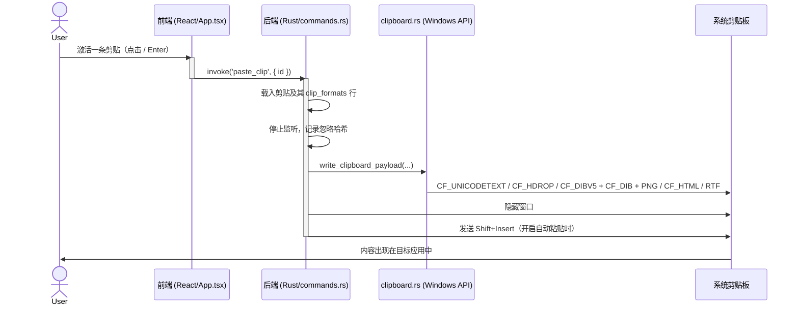

<h1 align="center">
    <picture>
      
    </picture>
    PastePaw - 剪贴板历史管理器
</h1>


<p align="center">
  <a href="README_CN.md">中文</a> •
  <a href="README.md">English</a>
</p>

<p align="center">
  <a href="https://github.com/cmacckk/PastePaw/actions/workflows/release.yml?branch=main"></a>
  <a href="https://github.com/cmacckk/PastePaw/releases"></a>
  <a href="LICENSE"></a>
</p>

一款为 Windows 打造的精美剪贴板历史管理工具，基于 Rust + Tauri + React + TypeScript 构建。

> ## 关于本分支
>
> 本仓库是 [XueshiQiao/PastePaw](https://github.com/XueshiQiao/PastePaw) 的 fork，仅维护 Windows 平台。
> 本 README 描述的是**本分支**，当前版本为 **v1.6.0**。上游维护自己的发布线，以及
> [App Store](https://apps.apple.com/us/app/pastepaw/id6759132043?mt=12) 上的 macOS 版本，
> 详见 [pastepaw.com](https://pastepaw.com/)。两者均为 GPL-3.0。

## v1.6.0 更新内容

v1.6.0 让剪贴板真正开始保存**格式**而不只是文本，并让三个「存在但从未生效」的设置真正起作用。

### 📄 文件与文件夹剪贴

在资源管理器中复制文件或文件夹会被记录下来。粘贴时它们以真正的文件列表写回剪贴板，资源管理器可以直接「粘贴」——支持多选，也支持整个文件夹。卡片上列出文件名而不是打印每条完整路径，页脚显示文件数量而非字符数量。


### ✍️ 富文本不再被压平

粗体、斜体、链接与表格同时以 `CF_HTML` 与 `CF_RTF` 保存，粘进 Word、Outlook 或编辑器时保留格式，而不会被压成纯文本。


### 🖼️ 图片透明通道得以保留

图片此前由前端 WebView 写入，而它只能产出不透明位图——透明 PNG 粘出后是**黑底**。现在图片由 Rust 直接写入 `CF_DIBV5`、`CF_DIB` 与 PNG，透明度与色彩深度都能保留。

### 🕘 历史保留终于真正生效

*可设定保留多少天、保留多少条。*这两个设置在早期版本的数据库里就存在，但**没有任何代码读取过它们**，导致数据库与磁盘上的历史无限增长。现在两者都已生效，内置文件夹不受限制。


### 📌 按 `P` 收藏

按 `P` 把选中的剪贴存入内置的 **收藏（Pinned）** 文件夹。这个快捷键在 README 与应用内文档里都写着，但从未接线——现在它能用了，而且文件夹内的内容豁免清理，与 Paste 的固定内容行为一致。

### 📤 导出与导入

把文件夹导出为一个可读的 JSON 文件，在另一台设备导入。导入时同名文件夹合并；内容按哈希比对，**同一份文件导入两次不会产生任何变化**；目标机器上找不到图片文件的条目会保留并标记，而不是被丢弃。


### 🗂️ 类型与来源筛选

按内容类型（文本 / 图片 / 文件）或按剪贴的来源应用缩小列表。


### 🏷️ 自定义标题与编辑内容

在右键菜单给剪贴起一个自己的名字，之后按该名字就能搜到它。文本剪贴还可以**直接编辑内容**——修改后会像新复制一样重新计算哈希（以后复制同样文本仍会正确去重），并丢弃旧的富文本副本（它描述的是旧内容）。


### ✨ 同一版本中的小改进

- **`Ctrl+1` 至 `Ctrl+9`** 直接粘贴列表前几条。
- **跳转到所在列表** —— 卡片显示它保存在哪个文件夹，点击即可跳转过去。
- **字体** —— 可分别设置界面与内容的字体、粗细，以及整体字号。
- **窗口动画更顺滑** —— 滑动改为缓出曲线，且每帧按固定时钟对齐。此前为线性位移，加上一个会被 Windows 不均匀向上取整的 sleep，表现为抖动。

### 🗑️ v1.6.0 移除的内容

**AI 功能**（总结 / 翻译 / 解释代码 / 修复语法）已移除，连同 AI 提供商配置、自定义动作名称与提示词、以及 API Key 输入框一并删除。代码中已无任何 AI 相关逻辑，也不再读取相关配置。这是一个纯本地、仅 Windows 的剪贴板管理器。

## 功能特性

- 🔒 **隐私** - 重要！所有数据都存储在本地
- 🎨 **精美界面** - 现代深色/浅色主题，支持原生 Windows Mica 与 Mica-Alt 窗口效果
- ⚡ **快速轻量** - 基于 Rust 构建，注重性能
- 📋 **剪贴板历史** - 自动保存你复制的所有内容
- 📄 **文件** - 复制文件与文件夹，粘贴时原样写回
- 🖼️ **图片** - 粘贴图片会保留透明通道（此前不会）
- ✍️ **富文本** - 粗体、斜体与链接在往返过程中保留
- 📁 **文件夹与钉板** - 把剪贴整理进文件夹，并从结果跳转到它所在的文件夹
- 📌 **按 P 收藏** - 一个键把选中剪贴存入收藏文件夹
- 🏷️ **自定义标题** - 给剪贴起一个自己的名字，之后按该名字查找
- ✏️ **编辑剪贴** - 右键文本剪贴即可修改内容
- 🗂️ **类型与来源筛选** - 按内容类型或来源应用缩小列表
- 🔍 **搜索** - 快速找到以前复制过的内容
- 🔢 **粘贴第 N 条** - `Ctrl+1` 至 `Ctrl+9` 粘贴列表前几条
- 🕘 **历史保留** - 可设定保留多少天、保留多少条
- 📤 **导出与导入** - 以可读的 JSON 文件在设备之间迁移文件夹
- 🔤 **字体** - 可设置界面与内容字体、粗细与字号
- 🖥️ **多显示器支持** - 在活动显示器上显示
- 🚫 **应用例外** - 忽略来自特定敏感应用的内容（如密码管理器）
- ⌨️ **自定义快捷键** - 设置你习惯的呼出快捷键
- 🔄 **无限滚动** - 无缝浏览不限量的历史记录
- 🛡️ **智能过滤** - 智能防抖逻辑，忽略来自其他剪贴板工具的「幽灵副本」

## 截图


### 浅色主题

### 深色主题


## 安装说明

### 从 GitHub Releases 下载

下载最新版本：

**https://github.com/cmacckk/PastePaw/releases**

每个 release 的命名可以直接区分两种形态：

| 文件 | 说明 |
|------|------|
| `PastePaw_<版本>_x64-setup.exe` | 安装版（x64）——安装到系统，带开始菜单项，可注册快捷键 |
| `PastePaw_<版本>_x86_64_portable.exe` | 便携版（x64）——单个 `.exe`，无需安装 |
| `PastePaw_<版本>_arm64-setup.exe` | 安装版（Windows on ARM） |
| `PastePaw_<版本>_aarch64_portable.exe` | 便携版（Windows on ARM） |

> **便携版**只需一个可执行文件：Rust 静态链接了依赖，WebView2 是 Windows 自带组件，因此单个 `.exe` 就是完整应用。

> 🔍 **安全**：每个 release 都会用 [VirusTotal](https://www.virustotal.com/)（70+ 杀毒引擎）自动扫描，扫描结果链接在每个 release 说明的底部。

> ⚠️ **本分支没有 `winget` 包。** `winget install XueshiQiao.PastePaw` 安装的是**上游**版本，其中不含上文列出的任何功能。请从本仓库的 Releases 页面安装。

## 键盘快捷键

### 全局
- **呼出/隐藏窗口**：`Ctrl+Shift+V`（默认，可在设置中修改）

### 应用内

- `Ctrl + F` - 聚焦搜索框
- `Escape` - 关闭窗口 / 清空搜索
- `Enter` - 粘贴选中条目
- `Delete` - 删除选中条目
- `P` - 收藏 / 取消收藏选中条目
- `Ctrl + 1..9` - 粘贴列表第 N 条，`Ctrl + 1` 为最新一条
- `↑` / `↓` - 上下移动选择

编辑剪贴内容没有绑定快捷键——它在右键菜单里。

## 应用例外（忽略的应用）

PastePaw 允许你把特定应用排除在剪贴板历史之外，适用于密码管理器、银行类应用等隐私敏感场景。

**逻辑与行为：**
- **如何管理：** 设置 -> 忽略的应用。可以浏览选择一个可执行文件（`.exe`），也可以严格输入它的名字。
- **隐私保护：** 有内容被复制时，PastePaw 会用来源应用去比对忽略列表。
- **双重匹配：** 系统会同时比对：
    1.  **可执行文件名**（如 `notepad.exe`）——匹配该应用的任何实例，不论位置。
    2.  **完整文件路径**（如 `C:\Windows\System32\notepad.exe`）——只匹配这一处安装实例。
- **不区分大小写：** 匹配不区分大小写，以确保在 Windows 上的可靠识别。

## 历史保留

设置 -> 通用 -> *保留历史*。

- **天数**与**条数**是两个独立上限，任一先达到就会移除剪贴。
- **内置文件夹与自建文件夹中的内容都不受限制** —— 你保存过的剪贴不会被这两个上限移除。
- 保留策略**只在有新剪贴进入时**执行，所以把旧剪贴粘贴回去不会被算作新内容，也不会把历史推过条数上限。

## 导出与导入

设置 -> 文件夹 -> *导出* / *导入*。

- 导出会写出**一个 JSON 文件**，包含所有文件夹以及其中的剪贴。
- 导入会**按名称合并文件夹**，并跳过内容哈希已存在的剪贴，因此同一份文件导入两次不会产生任何变化。
- 图片剪贴以**路径**形式保存，而非像素：图片文件存放在数据库之外。在另一台机器导入后，该剪贴会被保留并标记为图片缺失，而不是被静默丢弃。
- 导出的文件是可读、可 diff 的 JSON，不是二进制块。

## 技术栈

- **后端**：Rust + Tauri 2.x
- **前端**：React 18 + TypeScript
- **数据库**：SQLite（通过 `sqlx`）
- **剪贴板**：通过 `windows` crate 调用 Windows API（读写），`clipboard-rs` 负责监听
- **样式**：Tailwind CSS
- **窗口效果**：`window-vibrancy`
- **包管理器**：pnpm

## 快速开始

### 前置要求

- Node.js 18+
- Rust 1.70+
- pnpm
- 带有 **Desktop development with C++** 工作负载的 Visual Studio Build Tools，以及 Windows SDK

### 开发命令

```bash
# 安装依赖
pnpm install

# 安装 Tauri CLI
cargo install tauri-cli

# 启动开发构建
pnpm tauri dev
```

### 构建

```bash
# 生产构建
pnpm tauri build
```

必须先构建前端，Rust 侧才能编译：`tauri.conf.json` 的 `frontendDist` 指向 `../dist`，如果 `pnpm build` 还没有生成该目录，`cargo check` 会直接失败：

```
The frontendDist configuration is set to "../dist" but this path doesn't exist
```

### 测试

```bash
cd src-tauri
cargo test
```

剪贴板编解码（`CF_HDROP`、`CF_HTML`、`CF_DIB`）以及保留、导出、编辑等路径都有单元测试覆盖——它们的线格式是逐字节精确的，写错时只会表现为在别的软件里粘出乱码。

## 项目结构

```
PastePaw/
├── src-tauri/                  # Rust 后端
│   ├── src/
│   │   ├── main.rs             # 程序入口
│   │   ├── lib.rs              # 应用启动、窗口动画、托盘、快捷键、失焦处理
│   │   ├── clipboard.rs        # 剪贴板轮询、捕获、原生写回
│   │   ├── clipboard_formats.rs# CF_HDROP / CF_HTML / CF_RTF / CF_DIB 编解码
│   │   ├── database.rs         # SQLite 表结构与迁移
│   │   ├── commands.rs         # Tauri IPC 命令
│   │   ├── export.rs           # 文件夹导出与导入
│   │   ├── retention.rs        # 历史保留与条数上限
│   │   ├── pins.rs             # 内置「收藏」文件夹
│   │   ├── models.rs           # 数据模型与共享 tokio 运行时
│   │   └── settings_manager.rs # 带数据库持久化的内存设置缓存
│   └── Cargo.toml
├── frontend/                   # React 前端
│   ├── src/
│   │   ├── components/         # UI 组件
│   │   ├── hooks/              # React hooks
│   │   ├── i18n/               # 英文 / 中文 / 日文 / 法文 / 德文
│   │   ├── types/              # TypeScript 类型
│   │   └── App.tsx
│   └── package.json
└── README.md
```

## 开发说明

### Tauri 命令参数映射

Tauri v2 对 JavaScript/TypeScript 与 Rust 之间的参数名大小写有严格映射：

- **前端（JS/TS）：** `invoke` 调用的参数名使用 `camelCase`（如 `filterId`）。
- **后端（Rust）：** `#[tauri::command]` 的函数参数使用 `snake_case`（如 `filter_id`）。

**示例：**
*   **前端：** `invoke('get_clips', { filterId: 'pinned' })`
*   **后端：** `pub fn get_clips(filter_id: Option<String>)`

不符合该约定（例如前端传 `snake_case`）会导致参数以 `null` / `None` 传到后端。

### 窗口行为与多显示器支持

按下全局快捷键时，窗口会出现在**活动显示器**（鼠标所在的显示器）上。

- **检测逻辑：**
    - 位于 `src-tauri/src/lib.rs`（`animate_window_show`）。
    - 通过 `windows` crate 调用 Windows API `GetCursorPos` 取得全局鼠标坐标。
    - 遍历 `window.available_monitors()`，找到包含该坐标的显示器。
    - 兜底：无法确定鼠标位置时，回退到 `window.current_monitor()`。

- **定位：**
    - 窗口定位在检测到的活动显示器工作区（不含任务栏）的底部。
    - 动画从底部边缘向上滑入。

### 调整布局

应用使用集中式布局系统，确保原生窗口与虚拟列表保持同步。

-   **后端常量：** `src-tauri/src/constants.rs`（控制操作系统窗口尺寸）。
*   **前端常量：** `frontend/src/constants.ts`（控制 UI 渲染与计算）。

#### 如何修改卡片高度
卡片高度是动态的，会填满可用的窗口空间。修改方式：
1.  把 **`constants.rs` 与 `constants.ts` 两处**的 `WINDOW_HEIGHT` 改成同一个值。
2.  重启应用（Rust 改动必须重启才生效）。

#### 如何修改纵向间距（安全区）
用于调整卡片上下留白（例如避免鼠标悬停时被裁切）：
1.  修改 `frontend/src/constants.ts` 中的 `CARD_VERTICAL_PADDING`。
2.  该值调大，卡片**变矮**；调小则卡片**变高**。

## 架构与设计决策

### 一条剪贴如何保存它的多种格式

一条剪贴并不是一个字符串。`clips.content` 仍然是**主**载荷，因为搜索、去重（`content_hash`）与预览都读它；更丰富的格式副本放在第二张表里：

```sql
CREATE TABLE clip_formats (
    clip_uuid TEXT NOT NULL,
    format    TEXT NOT NULL,   -- 'text' | 'html' | 'rtf' | 'file'
    content   BLOB NOT NULL,
    created_at DATETIME DEFAULT CURRENT_TIMESTAMP,
    PRIMARY KEY (clip_uuid, format),
    FOREIGN KEY (clip_uuid) REFERENCES clips(uuid) ON DELETE CASCADE
)
```

对于文件剪贴，`clips.clip_type` 是 `"file"`，`clips.content` 存放换行拼接的路径（这样搜文件名能搜到），而 `clip_formats` 中的 `file` 行存放 JSON 数组，它才是重建的权威来源。

改动前需要知道两个后果：

- 级联删除依赖 `PRAGMA foreign_keys` 处于开启状态。如果它被关掉，删除剪贴会静默残留 `clip_formats` 行。
- 编辑剪贴文本时会**丢弃已保存的富文本副本**，因为它描述的是旧内容。保留它会导致在新文本下粘出旧格式。

### 为什么剪贴板由 Rust 写入

图片此前由前端通过 `navigator.clipboard.write` 写入，而它只能产出不透明位图——这正是透明 PNG 粘出后变成黑底的原因。从 v1.6.0 起，所有类型的剪贴都走同一个 Rust 写入器 `write_clipboard_payload`，它**一次性**把该剪贴拥有的全部格式写进剪贴板：

| 剪贴类型 | 写入的格式 |
|-----------|-----------------|
| 图片 | `CF_DIBV5`、`CF_DIB`、PNG |
| 文件 | `CF_HDROP`（UTF-16 路径列表，双 NUL 结尾） |
| 富文本 | `CF_HTML`（偏移量是从 0 开始的**字节**位置，包含 BOM）、`CF_RTF` |
| 文本 | `CF_UNICODETEXT` |

前端不再接触剪贴板：它调用 `paste_clip`，其余由后端完成。历史上之所以需要前端兜底，是因为 `OSError 1418`（"Thread does not have a clipboard open"）——Windows 把剪贴板访问绑定在拥有窗口的那个线程上，从后台 tokio 线程写入会产生竞态。原生写入器在 `CLIPBOARD_SYNC` 锁下取用剪贴板，并在期间停止监听，从而消除了这个竞态，而不是绕过它。

### 时间戳必须按 SQLite 自己的格式写入

列表是按**文本**比较 `created_at` 排序的。SQLite 的 `CURRENT_TIMESTAMP` 写入的是 `YYYY-MM-DD HH:MM:SS`，而 `'T'`（0x54）排在 `' '`（0x20）**之后**——所以一行如果用 RFC 3339（`2026-09-24T12:00:22+00:00`，也就是绑定 `chrono::DateTime` 的结果）插入，就会排到应用捕获的所有行之前，与真实时间无关。因此导入时显式格式化时间戳：

```rust
fn sqlite_timestamp(value: chrono::DateTime<chrono::Utc>) -> String {
    value.format("%Y-%m-%d %H:%M:%S").to_string()
}
```

如果要新增按文本排序或比较的列，务必与既有格式完全一致。

### 为什么默认用 `Shift+Insert` 粘贴？

默认用 `Shift + Insert` 触发粘贴，而不是 `Ctrl + V`。

-   **终端兼容性**：`Ctrl+V` 在终端模拟器（PowerShell、WSL、VS Code 终端）里常常失效，发送的是控制字符而不是粘贴。
-   **传统标准**：`Shift+Insert` 是几乎所有 Windows 应用（包括终端与老旧软件）都支持的通用粘贴标准。

### 粘贴流程时序图（Windows）



## 许可协议

GPL-3.0，详见 [LICENSE](LICENSE)。本分支保留了
[XueshiQiao/PastePaw](https://github.com/XueshiQiao/PastePaw) 的原始版权与许可。
